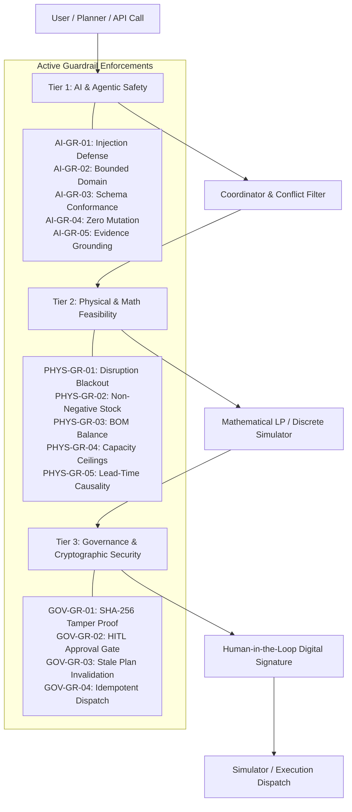

# Enterprise Guardrails & AI Safety Specification

This document details the multi-tier defense-in-depth safety architecture implemented across the **Resilient Supply Chain Platform**, adhering to **HITAM SOC-2 Type II / ISO 27001 AI Safety Profiles**.

---

## 1. Guardrails Architecture Overview

The system establishes three continuous runtime enforcement tiers protecting against adversarial attacks, physical operational infeasibilities, and unauthorized autonomous dispatches.

---

## 2. Guardrails Policy Registry (14 Active Enforcements)

### Tier 1: AI & Agentic Safety Guardrails

| Policy ID | Policy Name | Enforcement | Description |
|---|---|---|---|
| `AI-GR-01` | **Prompt Injection & Jailbreak Defense** | `HARD_BLOCK` | Intercepts adversarial prompts attempting system override, instruction bypass, role manipulation, or secret exfiltration. |
| `AI-GR-02` | **Bounded Operational Domain** | `SANITIZATION` | Restricts agent reasoning strictly to verified facilities (`S1`, `S2`, `S3`, `Plant-1`, `DCs`), catalog products, and non-negative quantities. |
| `AI-GR-03` | **Structured Output Schema Conformance** | `AUTO_REPAIR` | Validates agent outputs against canonical JSON contract (`observations`, `candidate_actions`, `confidence`, `evidence_references`). |
| `AI-GR-04` | **Zero Mutative Authority Policy** | `HARD_BLOCK` | Prevents agents from autonomously authorizing plans, executing orders, or altering stock. Agents are strictly bounded to `PROPOSED`. |
| `AI-GR-05` | **Evidence Grounding Mandate** | `WARNING_FLAG` | Requires every material recommendation to provide traceable evidence references back to the validated scenario snapshot. |

### Tier 2: Physical & Supply Chain Feasibility Guardrails

| Policy ID | Policy Name | Enforcement | Description |
|---|---|---|---|
| `PHYS-GR-01` | **Disrupted Sourcing Blackout** | `HARD_BLOCK` | Hard-blocks procurement orders originating from a supplier with an active outage during the order initiation window (e.g. S1 Days 1–7). |
| `PHYS-GR-02` | **Physical Inventory Non-Negativity** | `HARD_BLOCK` | Enforces mass conservation: on-hand stock at any facility at day $t$ cannot drop below zero ($I_{n,p,t} \ge 0$). Unconfirmed inbounds cannot be spent. |
| `PHYS-GR-03` | **BOM Material Balance** | `HARD_BLOCK` | Enforces strict Bill of Materials conservation: $1 \times COMP\text{-}A + 1 \times COMP\text{-}B \to 1 \times PROD\text{-}1$; $1 \times COMP\text{-}B \to 1 \times PROD\text{-}2$. Blocks assembly if components are deficient. |
| `PHYS-GR-04` | **Multi-Echelon Capacity Ceilings** | `CLAMP_OR_BLOCK` | Clamps production and shipment quantities to physical ceilings: Supplier capacities, Plant-1 max assembly (300 units/day), and corridor lane caps. |
| `PHYS-GR-05` | **Lead-Time Causality & Temporal Consistency** | `HARD_BLOCK` | Enforces temporal causality: arrival day strictly equals dispatch day + transport lead time ($t_{arrive} = t_{start} + L$). Rejects retro-causal deliveries. |

### Tier 3: Governance, Cryptographic Security & Human-in-the-Loop

| Policy ID | Policy Name | Enforcement | Description |
|---|---|---|---|
| `GOV-GR-01` | **Cryptographic SHA-256 Plan Signing** | `HARD_BLOCK` | Computes a SHA-256 hash across action payloads and cost metrics. Any payload tampering post-generation triggers immediate execution blocking. |
| `GOV-GR-02` | **Human-in-the-Loop (HITL) Approval Gate** | `HARD_BLOCK` | Prohibits autonomous execution of generated plans. Formal digital signature by an authorized human planner is required prior to dispatch. |
| `GOV-GR-03` | **State Freshness & Stale Invalidation** | `AUTO_INVALIDATE` | Automatically invalidates existing recovery plans if underlying scenario disruption parameters or network state change before execution. |
| `GOV-GR-04` | **Idempotent Dispatch Protection** | `HARD_BLOCK` | Enforces unique `idempotency_key` tokens. Duplicate network requests cannot trigger duplicate order generation or multiple fleet runs. |

---

## 3. Implementation Locations in Codebase

- **Central Guardrail Engine**: [`frontend/src/lib/guardrails.js`](file:///p:/Resilient%20Supply%20Chain(HITAM)/frontend/src/lib/guardrails.js)
- **Guardrails Telemetry & Test API**: [`frontend/src/app/api/guardrails/route.js`](file:///p:/Resilient%20Supply%20Chain(HITAM)/frontend/src/app/api/guardrails/route.js)
- **Agent Output Sanitization**: [`frontend/src/lib/agents.js`](file:///p:/Resilient%20Supply%20Chain(HITAM)/frontend/src/lib/agents.js#L613-L630)
- **Plan Generation Guardrail Scorecard**: [`frontend/src/app/api/plan/route.js`](file:///p:/Resilient%20Supply%20Chain(HITAM)/frontend/src/app/api/plan/route.js#L10-L30)
- **Execution Cryptographic & HITL Verification**: [`frontend/src/app/api/execute/route.js`](file:///p:/Resilient%20Supply%20Chain(HITAM)/frontend/src/app/api/execute/route.js#L14-L35)
- **Guardrails Interactive UI Dashboard**: [`frontend/src/components/GuardrailsView.tsx`](file:///p:/Resilient%20Supply%20Chain(HITAM)/frontend/src/components/GuardrailsView.tsx)
- **Repository & Secret Guardrails**: [`.gitignore`](file:///p:/Resilient%20Supply%20Chain(HITAM)/.gitignore) and [`.env.example`](file:///p:/Resilient%20Supply%20Chain(HITAM)/.env.example)
